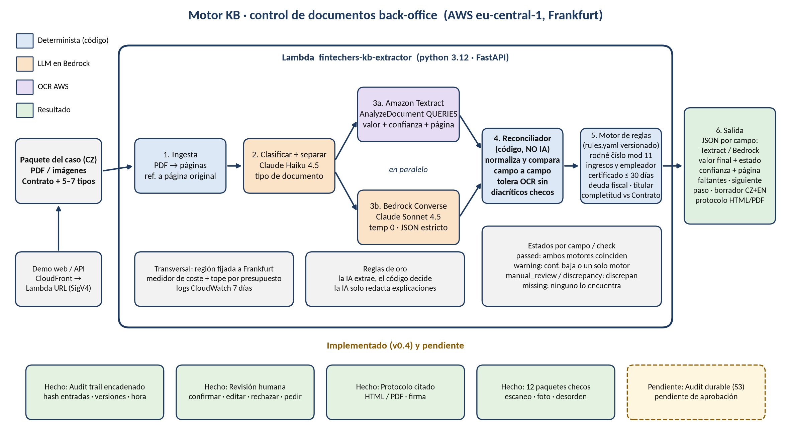

# Motor de control documental KB — Objetivo, estado y especificación

*Komerční banka · FinTechers Hackathon · Track 6 · autor: Carlos (motor) · frontend/Main Sequence: Jose*
*Versión del documento: 19-oct-2026 16:00 (Praga) · motor v0.4.0, commit `7c604b0`, desplegado. Code freeze: martes 20-oct-2026, 13:30 (Praga).*

---

## 1. Objetivo principal

**La pregunta del reto:** ¿cómo puede la IA hacer el control back-office de los paquetes de
documentos de un préstamo más rápido y fiable, manteniendo cada decisión explicable y auditable?

**El caso (mercado checo).** El back-office recibe un **paquete**: un **Contrato** (úvěrová smlouva)
que dice qué documentos hacen falta, más **5–7 tipos de documento DISTINTOS**:

| Código | Documento (CZ) | Para qué |
|---|---|---|
| `contract` | Úvěrová smlouva | define el caso y la lista de documentos obligatorios |
| `id_card` | Občanský průkaz | identidad, rodné číslo, dirección |
| `bank_statement` | Výpis z účtu | titular, IBAN, abono de salario |
| `payslip` | Výplatní lístek | empleador, ingreso neto |
| `proof_of_address` | Doklad o bydlišti (factura) | domicilio |
| `employer_confirmation` | Potvrzení o zaměstnání a příjmu | empleador, antigüedad, ingreso |
| `tax_or_debt_certificate` | Potvrzení o bezdlužnosti (Finanční úřad) | sin deudas fiscales, fecha reciente |

El motor debe: leer cada página (escaneos, fotos, desordenadas), saber qué documento es,
extraer los datos **citando página y confianza**, comprobar con **reglas configurables** que el
paquete está completo y es coherente, proponer el **siguiente paso**, redactar la **petición al
cliente** (checo + inglés), dejar que una persona **confirme / edite / rechace / pida
documentos**, y guardar **todo** en un registro de auditoría. La IA lee; **el código decide**.

---

## 2. Matriz de trazabilidad

Leyenda: **Hecho** = funciona y tiene test/eval · **Parcial** = funciona con límites · **Falta**.
Dueño: **C** = Carlos (motor/API) · **J** = Jose (frontend + Main Sequence).

| # | Requisito del brief | Estado | Evidencia | Hueco | Dueño |
|---|---|---|---|---|---|
| P1 | Ingesta de paquete (PDF/imagen, multi-archivo) | Hecho | `ingest.py`, `POST /extract`, `/extract_json`, `tests/test_ingest.py`, `test_api.py` | — | C |
| P2 | OCR con enlace a la página original | Hecho | Textract QUERIES + LINES, `page`/`bbox` por campo, `inputs[].sha256` | bbox solo de Textract; **Textract no tiene modelo checo** (pierde ř/č/š…), compensado en reglas | C |
| P3 | Clasificación de páginas | Hecho | `classify.py` (Haiku 4.5); eval: 100 % de 85 páginas (§3) | — | C |
| P4 | Bonus: separar/agrupar y páginas desordenadas | Hecho | `splitter.py`, paquetes 08 (escaneo) y 09 (desordenado), agrupación 12/12, `test_splitter.py` | 2 docs del mismo tipo sin clave se fusionan | C |
| P5 | Extracción por tipo con cita y confianza | Hecho | `extract.py` + `reconcile.py` (`source`, `page`, `confidence`), eval: 518/527 campos (98,3 %) | máx. 6 páginas por doc a Bedrock; fechas en cartas en prosa checa | C |
| P6 | 5–7 tipos distintos definidos por el Contrato | Hecho (v0.4) | `schemas.yaml` (7 tipos), `doclist.py`, 12 paquetes con 5, 6 o 7 tipos, `test_samples.py` | — | C |
| P7 | Motor de reglas configurable | Hecho | `rules.yaml` (versión sha256), `rules_engine.py`, `recheck`, `test_rules.py` | sin editor visual | C/J |
| P8 | Completitud vs Contrato | Hecho | `COMPLETENESS`, 2º lector determinista de la lista | — | C |
| P9 | Consistencia entre documentos | Hecho | `XDOC_*` (nombre, RČ, dirección, ingreso, empleador) | `_first`: compara el primer doc de cada tipo | C |
| P10 | Vínculos lógicos (fechas, vigencia) | Hecho | `RC_VALID`, `RC_BIRTHDATE_MATCH`, `ID_NOT_EXPIRED`, `DOC_RECENT` (≤ 30 días, configurable), `TAX_CLEAR`, `XDOC_HOLDER_RC` | sin regla de antigüedad mínima en el empleo | C |
| P11 | Siguiente paso recomendado | Hecho | `next_step` en rules.yaml; eval 7/12 exacto, **12/12 seguro** | los 5 fallos son más prudentes de lo esperado | C |
| P12 | Borrador de petición al cliente | Hecho | `draft_client_messages {cs,en}` | plantillas fijas (no LLM) | C |
| P13 | HITL confirmar/editar/rechazar/pedir | Parcial | `POST /runs/{id}/decisions`, `test_api_contract.py` | **la pantalla** es de Jose | J |
| P14 | Auditoría: versiones de input, regla/modelo, hora, historial humano | Parcial | `audit.py` cadena de hashes, `/verify`, `test_audit.py` | en Lambda vive en `/tmp` (efímero); no anclado fuera | C |
| P15 | Protocolo de control citado (HTML/PDF) | Hecho (v0.4) | `GET /runs/{id}/protocol` (verificado en AWS), CLI `protocol`, `test_protocol.py` | firma = manual | C |
| P16 | Auditoría duradera (sobrevive al contenedor Lambda) | Falta | — | requiere bucket S3 o tabla DynamoDB = tipo de recurso nuevo: **aprobación de Carlos** | C |
| D1 | Demo: camino feliz | Parcial | paquete 01: 48/48 campos, 0 falsas alarmas → `spot_check_warnings` | 2 avisos de confianza baja de Textract: el clerk los confirma y pasa a `approve_ready` | C/J |
| D2 | Demo: camino con error + petición | Hecho | paquetes con faltante/discrepancia → borrador | — | C/J |
| D3 | Demo: resolución humana + verify | Hecho | test `test_demo_story_...` | UI de Jose | J |
| E1 | Precisión | Hecho | `scripts/eval.py` sin caché: campos 98,3 %, checks 96,9 %, problemas 13/13 | datos sintéticos | C |
| E2 | Trazabilidad / explicabilidad | Hecho | cada campo/check cita `rule_id`, página, valores de ambos motores | — | C |
| E3 | Robustez | Parcial | escaneo, foto, rotación 180°, página faltante, desorden, 2–3 layouts y 5 fuentes por tipo | sin manuscritos ni sellos reales; 7 falsas alarmas (fechas en cartas checas) | C |
| E4 | Usabilidad back-office | Parcial | protocolo HTML, demo HTML mínima | UI final = Jose | J |
| G1 | Reglas separadas de la extracción y fáciles de cambiar | Hecho | `rules.yaml` + `recheck` sin AWS | — | C |
| G2 | Reglas que mejoran con decisiones reales | Parcial | `GET /learning` (sugerencias, nunca auto) | sin ciclo de aprobación de reglas | C |
| S1 | Paquetes sintéticos 5–7 docs, escaneos, páginas faltantes, datos incoherentes | Hecho (v0.4) | `scripts/gen_packages.py` (12 paquetes, 12 personas checas, RČ válidos), `samples/*/ground_truth.json` | — | C |

**Recuento (26 requisitos):** Hecho **19** · Parcial **6** · Falta **1**.

---

## 3. Qué tenemos

**Arquitectura** (`arquitectura_motor.png`):



```
Paquete ─► Ingesta ─► Clasificar (Haiku) ─► Agrupar ─► ┬─ Textract (OCR + confianza + bbox)
                                                         └─ Bedrock Sonnet (lectura visual)
                                ─► Reconciliador (código) ─► Reglas (rules.yaml) ─► Siguiente paso
                                ─► Borrador al cliente ─► Auditoría (cadena de hashes) ─► Protocolo
```

**Desplegado:** Lambda `fintechers-kb-extractor` (eu-central-1) detrás de CloudFront
`https://d31su4idgeitei.cloudfront.net/`, versión 0.4.0, commit `7c604b0`; verificado `/health`,
un extract firmado y el protocolo HTML + PDF de ese run.

### 3.1 Resultados medidos (eval real en AWS, SIN caché, 12 paquetes, 85 páginas)

| Paquete | Tipos | Campos | Checks | Problemas sembrados | Falsas alarmas | Siguiente paso (esperado) |
|---|---|---|---|---|---|---|
| 01 feliz, 7 tipos, layout A | 7 | 48/48 | 32/32 | 0/0 | 0 | spot_check_warnings (approve_ready) |
| 02 feliz, 7 tipos, layout B | 7 | 47/48 | 31/32 | 0/0 | 1 | spot_check_warnings (approve_ready) |
| 03 falta el certificado fiscal | 6 de 7 | 40/42 | 26/28 | 1/1 | 1 | request_missing_documents ✓ |
| 04 falta una página del extracto | 6 | 43/44 | 30/31 | 1/1 | 1 | request_missing_documents ✓ |
| 05 ingreso del empleador distinto | 7 | 48/48 | 32/32 | 2/2 | 0 | manual_review_discrepancy ✓ |
| 06 empleador distinto + certificado viejo | 7 | 46/48 | 31/32 | 2/2 | 1 | manual_review_discrepancy ✓ |
| 07 RČ inválido + typo de apellido | 6 | 42/42 | 24/27 | 3/3 | 0 | manual_review_discrepancy ✓ |
| 08 escaneado con ruido, 5 tipos | 5 | 38/38 | 27/27 | 0/0 | 0 | spot_check_warnings (approve_ready) |
| 09 páginas desordenadas, 6 tipos | 6 | 42/44 | 29/31 | 0/0 | 2 | manual_review_extraction (approve_ready) |
| 10 DNI en foto + deuda fiscal | 7 | 47/48 | 31/32 | 1/1 | 1 | manual_review_discrepancy ✓ |
| 11 doc extra + certificado de otra persona | 7 + otro | 44/44 | 31/31 | 3/3 | 0 | manual_review_discrepancy ✓ |
| 12 feliz, 5 tipos, layout B | 5 | 33/33 | 23/23 | 0/0 | 0 | spot_check_warnings (approve_ready) |

| Métrica global | Resultado |
|---|---|
| Clasificación de páginas | **100 %** (85/85) |
| Agrupación en documentos | **12/12** |
| Campos correctos | **518/527 = 98,3 %** |
| Checks correctos | **347/358 = 96,9 %** |
| Problemas sembrados detectados | **13/13** |
| Siguiente paso exacto / seguro | **7/12 / 12/12** (cada fallo es más prudente, nunca menos) |
| Faltantes, páginas faltantes, sobrantes | 12/12 cada uno |
| Coste | **2,30 USD** el eval completo ≈ 0,027 USD/página ≈ **0,19 USD por paquete** |

Re-ejecución con caché: números idénticos (temperatura 0, reglas deterministas).
Antes de los arreglos v0.4 (primer eval): campos 97,0 %, checks 94,7 %, siguiente paso 5/12 y **un
fallo inseguro** (el certificado titulado "sin deudas" cuyo cuerpo declara una deuda engañó a
los dos motores). Arreglado: el LLM recibe la pregunta y el lado OCR es una regla determinista
sobre el texto.

**Hallazgo clave: Textract no tiene modelo para checo.** Pierde letras acentuadas ('Ondřej' →
'Ondej', 'Kč' → 'K', 'října' → 'rjna') y no entiende prosa checa. Respuesta determinista, sin
tocar la verdad: acuerdo cuando la única diferencia son diacríticos (se guarda la grafía del
LLM), variantes OCR de meses checos, importes con la coma decimal perdida, regla OCR para
"nedoplatek". Lo que no se puede leer con seguridad va a revisión humana, nunca se aprueba solo.

---

## 4. Qué falta (ordenado por peso en la evaluación)

1. **Usabilidad back-office (pantalla de revisión)** — Jose: lista de casos, documento con el
   campo resaltado (página + bbox), botones confirmar/editar/rechazar/pedir, enlace al protocolo.
   La API ya está desplegada.
2. **Precisión en camino feliz** — los paquetes felices acaban en `spot_check_warnings` (avisos de
   confianza baja de Textract sobre texto checo) y la fecha de emisión de cartas en prosa checa va
   a revisión manual (6 de las 7 falsas alarmas). Siguiente mejora: regla OCR determinista para
   "V <ciudad> dne <fecha>".
3. **Auditoría duradera en Lambda** — hoy `/tmp` por contenedor. Requiere S3 o DynamoDB (tipo de
   recurso nuevo: **pedir permiso a Carlos**). Mitigación: abrir el protocolo justo tras el extract.
4. **Robustez con documentos reales** — sellos, manuscritos, fotos malas. Solo sintéticos.
5. **Ciclo de mejora de reglas** — hoy sugerencias; falta "proponer cambio de rules.yaml →
   revisión → nueva versión".
6. **Anclaje externo del hash de auditoría** (S3 Object Lock / firma KMS).

---

## 5. Especificación paso a paso (motor robusto)

Cada paso: módulo · entrada → salida · reglas deterministas · fallos y cómo se manejan · tests ·
criterio de aceptación.

### 5.1 Ingesta — `extractor/ingest.py`
- **Entrada:** 1..12 archivos (`PDF`, `PNG`, `JPEG`, `TIFF/WebP`), ≤15 MB c/u, ≤20 páginas total.
- **Salida:** `Page{source_file, page (1-based), png, sha256, source_sha256}` + `inputs[{name, original_name, bytes, sha256}]`.
- **Reglas:** tipo por *magic bytes*, no por extensión; nombres duplicados → `__2`; dpi 150
  (acotado en páginas gigantes); EXIF aplicado; límite 50 MP.
- **Fallos:** vacío 400; tipo 415; corrupto/cifrado 422; demasiado grande 413. **Nunca 500, y
  sin gastar AWS.**
- **Tests:** `test_ingest.py`, `test_api.py::test_bad_uploads_are_4xx_not_500`.
- **Aceptación:** todo input malo da 4xx con mensaje claro; hash de cada archivo y página en el audit.

### 5.2 Preprocesado
- Rotación 90/180/270 detectada por el clasificador y aplicada antes de extraer; re-codificación
  JPEG si una página supera el límite de Bedrock. Deskew fino no hace falta (±3° lo toleran ambos motores).
- **Aceptación:** paquete escaneado con una página al revés se lee igual que el limpio (eval).

### 5.3 Clasificación de páginas — `classify.py`
- **Salida por página:** `{doc_type ∈ DOC_TYPES, confidence, reason, page_number, page_count, doc_key, rotation, model}`.
- **Reglas:** tipo fuera de la lista → `other`; confianza robusta a texto; marcas "Strana x z y".
- **Fallos:** throttling → reintento y modelo de respaldo **marcado** (`MODEL_PRIMARY` = warning).
- **Aceptación:** ≥ 98 % de páginas bien clasificadas en el eval. **Medido: 100 %.**

### 5.4 Agrupar / separar — `splitter.py`
- **Salida:** documentos `{doc_id, doc_type, source_file, doc_key, pages[]}`.
- **Reglas:** (archivo, tipo, `doc_key`); número de página repetido ⇒ otro documento; orden por
  marca impresa. Una página "k de n" con k > 1 nunca abre documento si la anterior es del mismo
  tipo (clave mal leída en escaneos). Páginas sin marca legible ocupan los huecos. Huecos sin
  cubrir en "x de y" ⇒ `missing_pages`.
- **Aceptación:** paquetes desordenados agrupados 100 %; página faltante detectada.

### 5.5 Extracción por tipo — `extract.py`, `schemas.yaml`
- **Por documento y en paralelo:** Textract `AnalyzeDocument QUERIES` (valor, confianza, página,
  bbox) y Bedrock Sonnet 4.5 (JSON estricto, valor + página). Lista de documentos del Contrato:
  además, líneas OCR + parser determinista (`doclist.py`).
- **Esquema por campo:** `type ∈ {name, text, address, date, birth_number, amount, iban, id, doc_list, yesno, employment_term}`.
  Cada campo lleva una pregunta; **la misma pregunta va a Textract y al LLM**. Campos
  `textract: lines_rule` (deuda fiscal): el lado OCR es una regla regex sobre el texto (sin
  diacríticos) porque Textract no razona sobre prosa checa.
- **Fallos:** respuesta no-JSON del LLM ⇒ campo vacío (no tumba el run); caché por contenido.
- **Aceptación:** ≥ 97 % de campos correctos en el eval; cada valor con página.

### 5.6 Reconciliación — `reconcile.py` (código, no IA)
- **Salida por campo:** `{value, normalized, textract, textract_conf, bedrock, source, confidence, page, bbox, outcome, status, rule_ids}`.
- **Reglas (`FIELD_RECONCILE`):** iguales y conf ≥ 0,9 ⇒ passed; **iguales exactos y conf ≥ 0,5 ⇒
  passed** (doble lectura independiente); **solo difieren letras acentuadas que el OCR perdió ⇒
  `agree_ocr_no_diacritics`, passed con la grafía del LLM**; parecidos ⇒ warning; distintos ⇒
  manual_review; OCR ilegible ⇒ manual_review; ninguno ⇒ missing.
- **Aceptación:** ningún valor erróneo con `passed` en el eval.

### 5.7 Reglas — `cross_checks.py` + `rules.yaml`
- **Completitud:** el Contrato siempre; lista del Contrato (o por defecto); tipos desconocidos ⇒ manual_review.
- **Consistencia:** nombre, apellido (typo ⇒ warning), rodné číslo, dirección, titular, ingreso
  (contrato ↔ nómina ↔ extracto ↔ confirmación del empleador, tolerancia 1 %), empleador
  (nómina ↔ confirmación).
- **Vínculos lógicos:** RČ válido (mod 11, offsets, fecha no futura), fecha nacimiento ↔ RČ,
  DNI vigente a la fecha del contrato, certificado y confirmación de empleo ≤ 30 días
  (configurable; si los motores no coinciden en la fecha ⇒ revisión manual, nunca "caducado"),
  certificado sin deudas (`TAX_CLEAR`), titular del certificado = DNI (nombre + RČ).
- **Salida por check:** `{check_id, rule_id, rules_version, outcome, status, detail, evidence[{doc_id, field, value, page}]}`.
- **Aceptación:** 100 % de los problemas sembrados detectados, 0 falsas alarmas duras.
  **Medido: 13/13 detectados; 7 falsas alarmas, todas de revisión manual/aviso, ninguna discrepancia dura.**

### 5.8 Petición al cliente
- Plantillas deterministas por regla, **checo + inglés** (`draft_client_messages.cs/en`), solo si
  falta algo o hay discrepancia. El LLM no redacta (no inventa promesas).
- **Aceptación:** cada faltante/discrepancia del paquete aparece en el borrador.

### 5.9 Protocolo de control — `GET /runs/{id}/protocol` (HTML/PDF), CLI `protocol`
- Cabecera (caso, run_id, hora, versiones motor/reglas/modelos, hashes de entrada), resumen por
  estado + siguiente paso, tabla por check (rule_id, descripción, estado, evidencia: doc, página,
  valor de cada motor, confianza), faltantes + borrador, historial humano, pie
  "AI output supports the decision; not an automatic final approval", firma.
- **Aceptación:** generable offline desde el audit; mismo contenido que el JSON.

### 5.10 API HITL — `api.py`
- `POST /runs/{id}/decisions` (confirm/edit/reject/request_documents) ⇒ evento añadido, nunca se
  modifica nada; re-evaluación determinista; `GET /runs/{id}` estado actual.
- **Aceptación:** historia de la demo (discrepancia → edición → approve_ready → verify ok) en test.

### 5.11 Auditoría — `audit.py`
- JSONL por run, cada evento con `seq, ts, type, payload, prev_hash, hash`; eventos: run_started
  (inputs + hashes, reglas completas, modelos, git), classification, extraction, evaluation,
  run_completed, decision, reevaluation. `GET /runs/{id}/verify`.
- **Aceptación:** cualquier edición del archivo ⇒ `ok:false`.

### 5.12 Bucle de aprendizaje — `GET /learning`
- Agrega decisiones humanas por `rule_id` (confirmaciones vs overrides) y sugiere cambios con
  soporte mínimo. **Nunca se aplica solo**: un humano cambia rules.yaml (nueva versión).

### 5.13 Contrato API para Jose
- `docs/API.md` (ES+EN), `docs/openapi.json` generado y verificado por test; respuestas validadas
  por modelos pydantic; errores 400/401/404/409/413/415/422/500/502/503.

### 5.14 Despliegue — `deploy/deploy.sh`
- Lambda + Function URL (AWS_IAM) + CloudFront (OAC). Conserva env y token. Solo eu-central-1.
- **Aceptación:** `/health` muestra versión y commit; 401 sin token; extract firmado OK.

### 5.15 Coste
- Medidor por run y ledger con tope (`EXTRACTOR_BUDGET_USD` ⇒ 503 al superarlo); caché por contenido.
- Coste medido sin caché (v0.4): 0,027 USD/página, 0,19 USD por paquete medio, 0,215 USD por
  paquete de 8 páginas y 7 tipos.

---

## 6. Guion de demo (4 minutos) y preguntas

| Tiempo | Qué se ve | Qué se dice |
|---|---|---|
| 0:00–0:30 | Problema | "Un clerk tarda X min por caso comparando 7 documentos a mano." |
| 0:30–1:30 | Paquete feliz 01 (7 docs) → `spot_check_warnings` | 48/48 campos, cada uno con página y confianza; 2 avisos de confianza baja: el clerk confirma con un clic → `approve_ready` |
| 1:30–2:30 | Paquete 05 (ingreso del empleador ≠ contrato) o 10 (deuda fiscal) → `manual_review_discrepancy` + borrador CZ/EN | la regla que salta, evidencia con página y valores de ambos motores |
| 2:30–3:15 | Clerk edita/confirma → `approve_ready`; `/verify` ok | auditoría: nada se borra, todo encadenado |
| 3:15–4:00 | Protocolo PDF citado + rules.yaml | "cambiar una regla = editar YAML, nueva versión, re-evaluar sin coste" |

**¿Por qué determinista?** Porque el banco tiene que poder explicar cada decisión: la IA lee
(dos lectores independientes), pero el valor final y el estado los decide código versionado y
testeado. El mismo input + las mismas reglas = el mismo resultado.

**¿Dónde se procesa?** AWS Frankfurt (eu-central-1): Lambda, Textract. Bedrock vía perfiles
`eu.*` (puede usar otras regiones de la UE; los datos no salen de la UE).

**GDPR:** datos solo sintéticos en el hackathon; en producción: minimización (solo campos del
esquema), retención configurable, no se entrena con los datos (Bedrock no usa inputs para
entrenar), auditoría de acceso y decisiones, derecho de revisión humana (art. 22: nunca
aprobación automática final).

**Coste por paquete:** medido sin caché 0,19 USD de media (0,215 USD con 7 documentos y 8 páginas;
0,14 USD con 5 páginas). Re-evaluar con reglas nuevas cuesta 0 (se re-aplica sobre el audit).

**¿Y el checo?** Textract no lee checo bien; por eso hay dos lectores y el código decide: si
solo difieren los acentos, gana la grafía del LLM; si no coinciden, decide una persona.

---

## 7. Plan hasta el code freeze (mar 20-oct 13:30, Praga)

| Cuándo | Qué | Dueño | Estado |
|---|---|---|---|
| lun 15:00–16:00 | 7 tipos, 12 paquetes, protocolo, borrador CZ/EN, eval real sin caché, redeploy v0.4.0 | Carlos | hecho |
| lun 16:00–20:00 | Main Sequence contra la API desplegada; spec, notas, handoff, zip | Carlos + Jose | en curso |
| lun 20:00–22:00 | Jose conecta frontend a `/extract_json`, `/runs`, `/decisions`, `/protocol` | Jose | pendiente |
| lun (decisión) | ¿auditoría duradera? (S3/DynamoDB = recurso nuevo) | Carlos | pendiente |
| mar 08:00–10:00 | prueba conjunta con el guion (§6), bugs; opcional: regla OCR de fecha en cartas | Carlos + Jose | pendiente |
| mar 10:00–12:00 | ensayo de la demo ×2, congelar `rules.yaml` | Carlos + Jose | pendiente |
| mar 12:00–13:30 | solo fixes críticos; 13:30 code freeze; push cuando Carlos lo diga | Carlos | pendiente |
